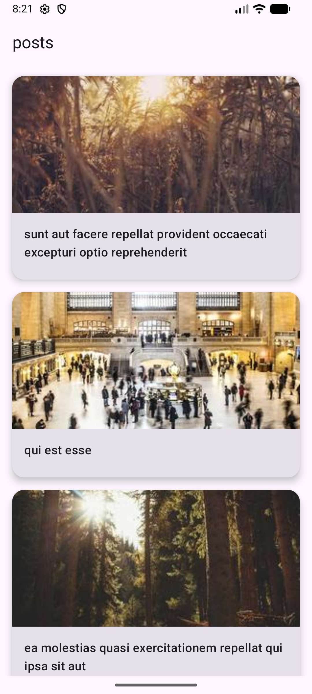
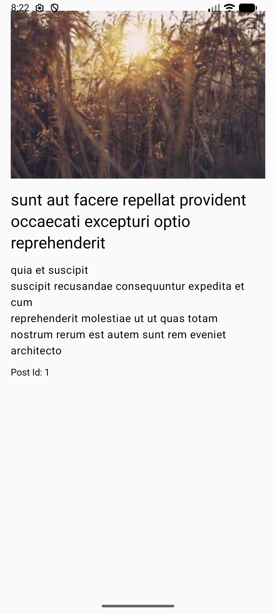

# GalleryApp

GalleryApp is a sample Android app that displays posts as an image-backed gallery. Browse the post list, tap an item to read its full title and body, and view a related image on both screens.

## Features

- Fetches posts and individual post details from JSONPlaceholder.
- Shows post cards with images from Picsum Photos.
- Navigates from the gallery list to a post detail screen.
- Uses separate data, domain, and presentation layers.

## Tech stack

- Kotlin and Jetpack Compose with Material 3
- AndroidX Navigation Compose
- Retrofit and Gson for HTTP and JSON
- Hilt for dependency injection
- Kotlin Coroutines and `StateFlow`
- Coil for image loading
## Screenshots

| Gallery | Post details |
|---|---|
|  |  |

## Architecture

The app separates UI, business logic, and data access:

```text
app/           Application entry point and Compose theme
feature_posts/ Post list, detail screens, navigation, and ViewModels
domain/        Post model, repository contract, and use cases
data/          Retrofit API, DTO mapping, and repository implementation
core/          Shared constants
```

Post data flows from the Retrofit service through the data repository and domain use cases to the presentation ViewModels and Compose screens.

## Data sources

- Posts: [JSONPlaceholder](https://jsonplaceholder.typicode.com/) (`/posts` and `/posts/{id}`)
- Images: [Picsum Photos](https://picsum.photos/) (image URLs are generated using each post's ID)

No API key or additional service configuration is required.

## Requirements

- Android Studio with Android SDK 36 installed
- JDK 17
- Android device or emulator running Android 7.0 (API 24) or later

## Build and run

1. Clone the repository and open it in Android Studio:

   ```bash
   git clone https://github.com/manisha8547/GalleryApp.git
   ```

2. Allow Gradle to sync and download dependencies.
3. Select the `app` run configuration and run it on a device or emulator.

To build the debug APK from a terminal:

```bash
# Windows
gradlew.bat assembleDebug

# macOS or Linux
./gradlew assembleDebug
```

The APK is generated at `app/build/outputs/apk/debug/app-debug.apk`.

## Tests

Run the unit tests from the project root:

```bash
# Windows
gradlew.bat test

# macOS or Linux
./gradlew test
```
